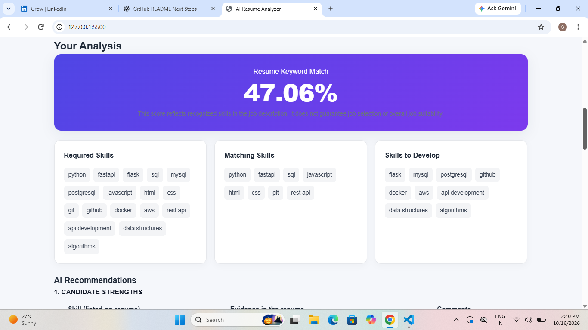

# AI Resume Analyzer

An AI-powered web application that analyzes resumes against job descriptions.

## Features

- PDF Resume Upload
- Resume Text Input
- Skill Matching
- Match Score
- AI Recommendations
- PDF Report Download
- Input Validation

## Tech Stack

- Backend: Python, FastAPI
- AI Integration: Groq API
- Frontend: HTML, CSS, JavaScript
- PDF Processing: pypdf
- Validation: Pydantic


## Project Structure

```text
AI-Resume-Analyzer/
├── frontend/
│   ├── index.html
│   ├── style.css
│   └── script.js
├── main.py
├── requirements.txt
├── .env
├── .gitignore
├── test_latency.py
└── README.md
```


## Getting Started

### 1. Clone the Repository

```bash
git clone https://github.com/sarabhamma-collab/AI-Resume-Analyzer.git
cd AI-Resume-Analyzer
```

### 2. Create a Virtual Environment

```powershell
py -3.12 -m venv venv
.\venv\Scripts\Activate.ps1
```

### 3. Install Dependencies

```bash
python -m pip install -r requirements.txt
```


### 4. Configure the Groq API Key

Create a `.env` file in the project root and add your Groq API key:

```text
GROQ_API_KEY=your_groq_api_key_here
```

Replace the placeholder with your actual API key. Never upload your real API key or `.env` file to GitHub.


### 5. Run the Backend

From the project root, run:

```bash
uvicorn main:app --reload
```

- Backend API: http://127.0.0.1:8000
- API Documentation: http://127.0.0.1:8000/docs


### 6. Run the Frontend

Open a second terminal in the project root and run:

```powershell
cd frontend
python -m http.server 5500 --bind 127.0.0.1
```

Open http://127.0.0.1:5500 in your browser.


## How to Use

1. Upload a PDF resume or paste resume text.
2. Enter the job description.
3. Click Analyze My Resume.
4. Review the match score and matching skills.
5. Read the AI-generated recommendations.
6. Download the PDF analysis report.


## Security

- Keep API keys in the local `.env` file.
- Add `.env` to `.gitignore`.
- Never commit secrets to GitHub.
- Handle resume information carefully because it may contain personal data.


## Performance Benchmark

The API was tested with 10 requests.

- Successful Requests: 10/10 (100%)
- Failed Requests: 0
- Median Response Time: 3.91 seconds
- Average Response Time: 4.17 seconds

These results are from a single 10-request benchmark run. Actual performance may vary depending on network conditions and API response times.


## Future Improvements

- Better skill extraction and synonym matching.
- Resume section analysis.
- Job-specific interview question generation.
- More automated testing and deployment.


## Application Screenshot



## Author

Sara Garg

GitHub: https://github.com/sarabhamma-collab
